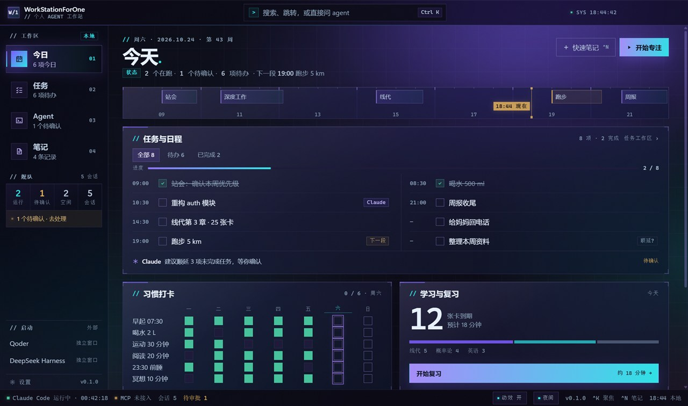
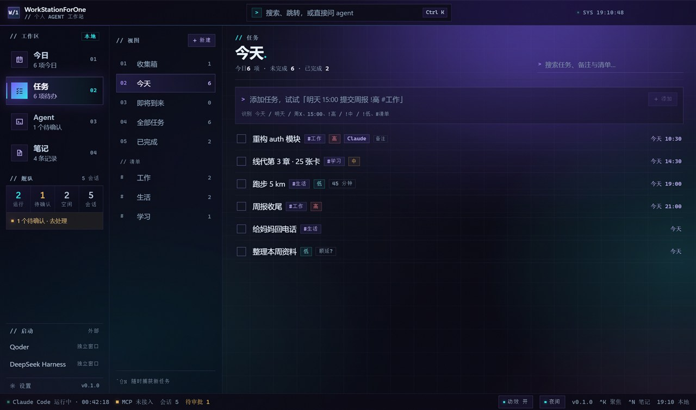
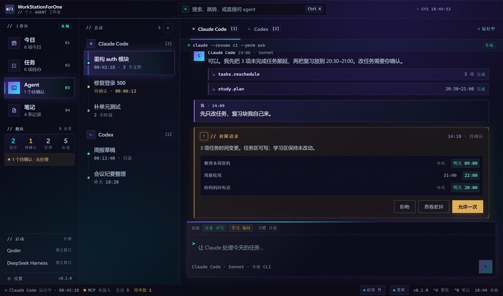
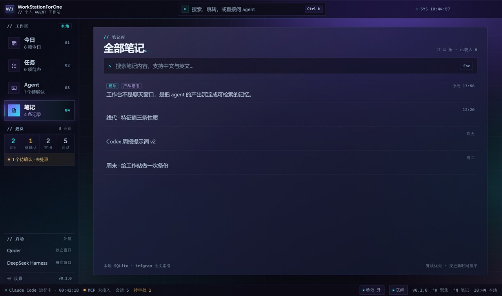

# WorkStationForOne

Windows 上的个人 AI 工作站。把「今日看板 + 任务清单 + Agent 工作区 + 笔记库 + 闪卡复习」收进一个窗口：左侧导航一次只打开一个全宽工作区，Agent 视图里调度 Claude Code / Codex 会话、对话并审批它对数据的写入。

> 当前版本 v0.0.8。任务（含清单）、笔记、学习闪卡与习惯已落库；真实 Claude Code 适配器可用（只读工具）。MCP、审计与打包尚未实现。

## 特点

- **一个窗口完成一天的调度**：左侧一级导航在今日 / 任务 / Agent / 笔记 / 学习之间切换；今日聚合任务摘要、习惯打卡、学习与复习、快速笔记四块看板，配时间轴与舰队状态。
- **完整的任务工作区**：收集箱、今天、即将到来、全部、已完成与自定义清单；快速添加支持「明天 15:00 提交周报 !高 #工作」这类中文输入，输入时预览解析结果、提交后提示去向；行内详情支持今天/明天/清除快捷日期、备注与优先级，勾选、编辑与删除都写入 SQLite。
- **Agent 是独立工作区**：会话列表 + 宽聊天区；Agent 想改任务时间时，弹出逐行 diff 的权限卡（旧值划线、新值高亮），你点「允许一次」才写入。
- **可扩展的外壳**：新应用作为一级导航项接入，各自拥有全宽工作区；看板与 Agent 不同屏，也不存在常驻右栏。
- **本地优先**：数据只存在本机 SQLite；不使用云同步、不上传遥测、不保存 API Key。
- **中文优先的 HUD 界面**：极光玻璃、直角、终端式元素；夜色与白天双主题，动效可整体关闭，也尊重系统的「减少动效」设置。
- **间隔重复复习**：考研英语二与互联网知识的闪卡；今日卡告诉你今天几张到期、约几分钟，进复习态翻面评分（重来 / 困难 / 良好 / 简单），调度按 SM-2 变体落在主进程，隔天自动回来。
- **笔记全文搜索**：SQLite FTS5 + trigram 分词，中文与英文都能检索，两字短词自动回退模糊匹配。









## 技术栈

| 层 | 选型 |
| --- | --- |
| 桌面壳 | Electron 45（sandbox + contextIsolation，仅暴露窄 preload 桥） |
| 界面 | React 19、TypeScript、Zustand、Motion、cmdk |
| 数据 | Electron 内置 `node:sqlite`（WAL、`PRAGMA user_version` 前向迁移、FTS5） |
| 构建 | electron-vite、Vite 8、Vitest |

不引入原生 SQLite 模块，因此没有 `@electron/rebuild` 与 ABI 匹配问题。

## 快速开始

需要 Node.js 22.12+（Vitest 5 的要求）与 Windows 10/11。

```bash
npm install
npm run dev
```

窗口会自动打开，改代码热更新。

## 常用命令

| 命令 | 作用 |
| --- | --- |
| `npm run dev` | 开发模式启动，支持 HMR |
| `npm run build` | 生产构建，输出到 `out/` |
| `npm start` | 预览上一次构建 |
| `npm run typecheck` | 类型检查（main/preload 与 renderer 各一套配置） |
| `npm test` | 运行全部单元测试（401 项） |
| `npm run check` | Biome 检查格式与 lint（Rust 单二进制，不依赖 Prettier / ESLint） |
| `npm run smoke` | 构建后跑 UI 交互冒烟（178 项，真实主进程 + 临时 SQLite） |
| `npm run verify` | 启动真实主进程跑 244 项运行时断言（五视图、双主题/皮肤、跨重启） |
| `npm run capture -- .screenshots/home.png 1440 900 .screenshots/audit.json` | 截图并输出布局审计 |
| `npm run capture -- .screenshots/notes-1180.png 1180 720 .screenshots/audit-notes.json dark notes` | 指定主题 `dark|light` 与视图 `today|tasks|agent|notes|learning` 截图 |
| `npm run icon` | 从 `resources/icon.svg` 重新生成 PNG 与多尺寸 ICO |

请始终通过上述封装脚本启动 Electron：开发环境可能设置了 `ELECTRON_RUN_AS_NODE=1`，脚本会清除它并正确解析 electron-vite。

## 目录结构

```
src/
  main/                 主进程：唯一持有数据库、子进程与权限
    db/                 连接、迁移、任务、笔记与学习仓储
    ipc/                IPC handler 与入参校验
  preload/              暴露 window.ws 的窄类型化桥
  renderer/             界面（无 Node、无数据库、无文件系统权限）
    src/components/     左侧导航、今日看板、任务 / Agent / 笔记 / 学习工作区、浮层
    src/lib/            纯函数规则（日程、任务筛选、快速添加解析、命令、舰队统计、虚拟滚动）
    src/store/          Zustand 状态
  shared/ipc.ts         IPC 通道常量与跨进程类型契约
  shared/date-key.ts    本地日期键与日期运算
  shared/srs.ts         间隔重复调度（纯函数，主进程执行）
resources/              应用图标源文件与产物
scripts/                开发、构建、冒烟、截图、图标生成脚本
docs/superpowers/specs/ 产品与架构设计规格
```

## 数据

- 位置：`%APPDATA%\WorkStationForOne\data\workstation.db`
- 已落库：任务（含清单、截止日期、计划日期、预计时长、优先级、备注、完成状态与时间变更）、笔记（含全文索引）、学习卡片与复习记录
- 全局快速捕获：`Ctrl+Alt+Space` 随时记一条，落库后主窗口即时刷新
- 尚未落库：习惯、会话与消息——这些目前仍是内存种子数据，重启会重置

删除该目录即可回到初始状态。

## 安全边界

- 渲染进程没有 Node、数据库或文件系统访问权；所有能力经 `src/shared/ipc.ts` 的类型契约 + 主进程入参校验。
- 应用是单实例的；关闭窗口即退出。
- 仓库不包含任何密钥、登录态或个人配置。

## 已知限制

- 尚未接入真实 Agent：对话区回复是固定演示数据，不会真正调用 Claude 或 Codex。
- 设置、审计、MCP 服务端、每日备份与安装包均未实现。
- 任务暂不支持子任务、循环任务、系统提醒与清单重命名。
- 学习域 v1 只做识别型词汇卡，不含拼写、作文模板、导入导出与到期提醒推送。
- 仅支持 Windows；默认夜间主题，可在状态栏或命令面板切换到白天模式。

## 文档

- 设计规格：[docs/superpowers/specs/2026-10-23-workstation-design.md](docs/superpowers/specs/2026-10-23-workstation-design.md)
- 协作约定：[AGENTS.md](AGENTS.md)
