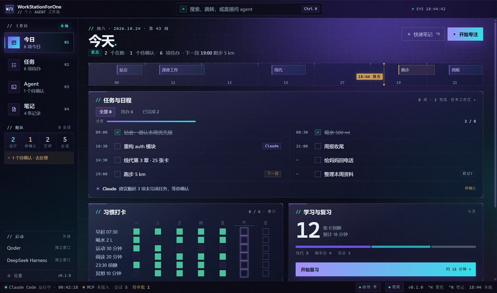
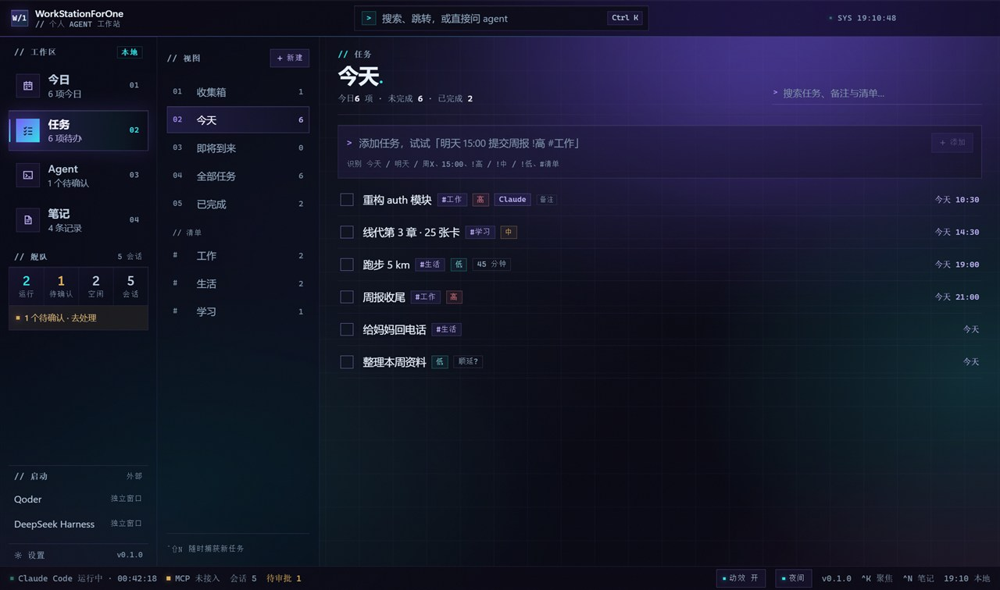
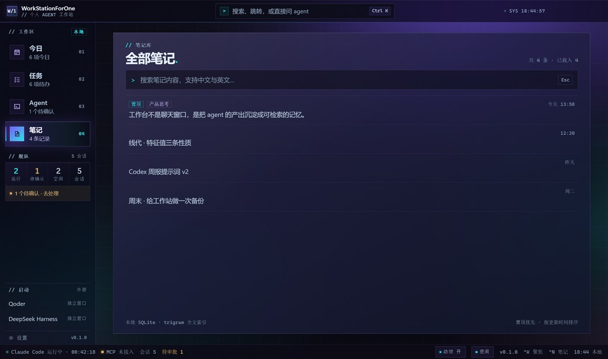

# WorkStationForOne

Windows 上的个人 AI 工作站。把「今日看板 + 任务清单 + Agent 工作区 + 笔记库 + 闪卡复习」收进一个窗口：左侧导航一次只打开一个全宽工作区，Agent 视图里驱动本机 Claude Code CLI 对话，任务、笔记、学习与习惯全部落在本机 SQLite。

> 当前版本 v0.79.0（2026-11-10），数据库 v47。逐项实现状态、数据库版本与最近验证结论以 [docs/status.md](docs/status.md) 为准；这里只保留用户视角的功能概览。

## 特点

- **一个窗口完成一天的调度**：左侧一级导航在今日 / 任务 / Agent / 笔记 / 学习之间切换；今日聚合任务摘要、习惯打卡、学习与复习、快速笔记四块看板，配时间轴与舰队状态。
- **完整的任务工作区**：收集箱、今天、即将到来、全部、已完成与自定义清单；快速添加支持「明天 15:00 提交周报 !高 #工作」这类中文输入，输入时预览解析结果、提交后提示去向；行内详情支持今天/明天/清除快捷日期、备注与优先级；今日卡标题栏也能「快速添加」，直接切到任务工作区并聚焦输入框。另有「计划今天」与容量条、排程预览、拖拽改期、周视图（任务卡 `Alt + ←/→` 键盘排期，未排期条 `Alt + →` 排到周一）、重复任务、子任务、到点提醒、提醒中心（可「今天不再提醒」并按天恢复，稍后支持 10/30/60 分钟与明天 09:00）、「只做三件事」、清单重命名、收集箱逐条整理（设清单 / 日期 / 优先级，完成、删除或留到以后）与完成记录热力图。
- **Agent 回复 Markdown**：助手正文渲染加粗、列表、表格、引用、行内代码与代码围栏，代码块带复制按钮与语法着色；链接外开，图片只显示 alt 文本，不执行 HTML。
- **Agent 交互问答**：Claude 的 AskUserQuestion 会弹出独立问题卡，支持单选、多选与「其它」自由输入；提交后答案回写 CLI 并继续本轮，也可以拒绝回答。
- **Agent 文件改动预览**：审批卡和文件写入工具卡展示真实 diff（新增 / 删除 / 修改），允许前就能看清会改什么；可展开原始参数。只读工作区内文件，大文件只显示改动附近片段。
- **后台审批通知**：离开窗口时，工具审批、Agent 提问与 MCP 写入审批会弹系统通知；点击通知恢复窗口、切回对应会话，并把审批卡滚到视野内。窗口在前台时不打扰。
- **@ 文件上下文**：输入栏输入 `@` 从工作区文件树挑选文件，附件标签随消息发送。文件内容由主进程读取后注入提示词（单文件 128 KB、总计 256 KB、最多 8 个），越界或读不到会明确报错；消息只保存路径，重试、分叉与导出都会带上附件清单。
- **检查点与回退**：Agent 写入文件前自动留底，顶栏「检查点」可按回合回退；只改工作区文件，不改对话。运行中禁止回退，二进制与超大文件会标记为不可回退；每个会话保留最近 50 个、总量不超过 32 MB 的检查点。
- **计划模式**：输入栏一键切到只读规划，Claude 与 Codex 都只调查并给方案，不执行写入；主进程在审批与 MCP 写入前再挡一次，确认方案后切回执行。
- **图片输入**：输入栏可粘贴或选择图片（PNG / JPEG / WebP / GIF，最多 6 张），消息显示缩略图；图片存在应用私有目录，Claude 以 base64、Codex Provider 会话以本地图片发送。删除会话时清理不再被其它消息引用的图片文件。
- **长会话不一次渲染**：Agent 线程默认只挂最近 60 条，滚到顶部自动加载更早一批，跳转旧消息时会先扩窗定位；长会话滚动更轻。
- **错误说清哪里错了**：认证、模型不存在、上下文超长、额度不足、限流、服务过载、协议错配、图片不支持都会显示中文原因与下一步；供应商原文收进「查看详情」，默认收起并脱敏。有激活 Provider 时输入栏显示当前名称与模型；CLI 会话丢失会提示新建或导入。
- **Agent 是独立工作区**：默认空态，可新建 Claude 或 Codex 会话；每个会话先选择自己的项目目录，未选择时输入框禁用，选择后 Claude 与 Codex 都只在该目录里运行。Claude 走本机 `claude` CLI（stream-json），流式文本与工具调用卡直接进线程；会话标题取自首条消息，消息与工具卡落 SQLite，resume id 也保存下来，重启后能继续。不同会话可以同时运行：各自的事件按运行 id 回到发起会话，后台会话的审批卡不会抢占当前聊天，输入栏上方会提示其它会话的待审批数量。读工具（Read / Glob / Grep / LS）自动放行；编辑、写入、Bash 等工具会弹出「允许一次 / 本会话允许 / 拒绝」审批卡，可逐次裁决或本会话放行。Codex 继承 CLI 时走 `codex exec --json` 的只读沙箱；保存并启用 Codex Provider 后改走 `codex app-server --stdio`，使用应用自己的 `codex-home`，线程以工作区权限 + `on-request` 运行，命令执行、文件改动和额外权限请求都会接到同一张审批卡。设置里可切「继承 CLI」或自定义 Provider；自定义配置只影响本应用启动的进程，API Key 用系统加密存本机，绝不回显。命令面板可跨任务、笔记、会话与学习卡全局搜索（笔记直接开详情、学习卡定位高亮）；助手消息悬停可「分叉」出新会话：Claude 最新一条回复用 `--resume --fork-session`，Codex 激活 Provider 后可从任意助手回合用 `thread/fork` 的 `lastTurnId` 延续到该回合为止的真实上下文；Claude 较早消息或没有 Provider 时只复制到此为止的对话与工作区，按钮提示与结果提示会区分两种模式。会话栏支持按标题与消息正文搜索（正文命中可跳到消息）、双击或 F2 重命名、悬停 ☆/★ 置顶、顶栏导出 Markdown，以及两段确认删除——删除只作用于应用内会话与消息，运行中禁用，外部 CLI 的历史文件不动。
- **舰队控制台**：状态栏「舰队 N」、左侧舰队区和命令面板都能打开统一总览。所有 Claude / Codex 会话按 Agent 分组，显示运行 / 待审批 / 空闲、工作区、消息数、排队状态与审批数量；可筛选、打开、停止运行中的会话，归档/取消归档，或直接新建。还能保存「当前会话 + 工作区」为预设，一键用相同工作区新开会话；「用量」展示近 7 天运行、成本、时长、轮次与每日柱。「导入本机」只读扫描 Claude / Codex CLI 的 JSONL，导入标题、工作区、resume id、最近 200 条只读历史与工具卡；已有导入会话可「补历史」。它统一的是本应用启动/恢复的会话，不接管外部终端窗口。
- **工作区文件与产物**：Agent 顶栏「文件」打开只读工作区文件树，跳过 `.git / node_modules / dist`，点击文件预览文本（上限 128 KB）；Write / Edit / Patch 工具里出现的文件汇总为「本回合产物」，可一键定位预览。不内置编辑器。
- **能力中心**：设置页分「基础 / 能力中心」，能力中心按「插件 / 技能 / MCP / 内置工具 / 推荐」五个 tab 组织。插件页管包生命周期：官方市场浏览安装（按热度排序、分批加载）、插件源、本机只读导入、本地 `SKILL.md` / 插件目录导入、更新与卸载；技能页按 Claude / Codex 统一启停与信任（唯一入口）、查看源文件与 SKILL.md 预览、调顺序；MCP 页管外部 Server：内置目录、自定义 stdio / HTTP、密钥加密、启停、更新检查、连接测试、工具级「自动 / 询问 / 禁止」、OAuth 登录与 `mcpServers` JSON 导入导出；内置工具页顶部是 CLI 环境自检（node / npx / uvx / git / claude / codex），下面按 Agent 列出原生工具开关（读文件 / 改文件 / 命令 / 网络 / 子任务 / 待办 / 问答 / 技能加载 / 计划模式，Codex 另有桌面 / 浏览器操作；CLI 拦不住的标「常开」不给假开关）。MCP 与技能可标 ★ 首选并写一句 80 字内的用途说明，会话启动注入系统提示的「首选」分组，要求能做同一件事时不改用 CLI 原生工具（URL / 密钥自动脱敏；Claude 走 `--disallowedTools` + `--append-system-prompt`，Codex 走 `-c` 参数 + `developerInstructions`），注入原文在内置工具页直接预览；关闭 Shell 或修改文件时会在审批前直接拒绝。应用自己的任务 / 笔记 / 学习 / 习惯数据桥与四域权限在基础设置的「数据桥」分区，不与编码能力混排。新装默认停用，带 hooks/MCP 的插件与外部 Server 需要二次确认信任；工具级自动批准只建议用于只读工具。所有记录都在 WorkStationForOne 自己的库里，不写 `~/.claude`、`~/.codex`、CC Switch 或桌面端配置。
- **按需加载**：今日首屏只加载外壳与今日看板；任务、笔记、学习、Agent、设置与舰队工作区按视图加载，Markdown 渲染与文件 diff 预览也按需加载。首屏 JS 从约 2.99 MB 降到 1.24 MB（约 59%）。
- **可扩展的外壳**：新应用作为一级导航项接入，各自拥有全宽工作区；看板与 Agent 不同屏，也不存在常驻右栏。
- **本地优先**：数据只存在本机 SQLite；不使用云同步、不上传遥测；默认不保存 API Key，只有显式保存的自定义 Provider Key 会以系统加密存本机。
- **备份与恢复**：每天首次启动自动生成数据库快照，设置页「数据」可立即备份、查看快照并一键恢复；恢复前自动留安全快照，损坏或版本不兼容的备份会被拒绝，恢复在下次启动前执行，失败自动回滚。
- **中文优先的 HUD 界面**：极光玻璃、直角、终端式元素；夜色与白天双主题，动效可整体关闭，也尊重系统的「减少动效」设置。任务完成有复选框弹跳与行扫光，提醒行会滑出并把静音条淡入，周视图键盘移动有棱镜脉冲，切换工作区时有一条 HUD 扫线；卡片跟随指针聚光，运行中的会话与待审批卡带旋转光束，主按钮按下散开水波纹，状态栏数字滚动更新。
- **间隔重复复习**：面向 MEM 初试的闪卡，默认科目为英语二 / 管综数学 / 管综逻辑 / 管综写作；调度使用 **FSRS-6**（默认参数、90% 目标保留率），评分 1 留在今天，具体公式与参数见 `shared/srs.ts`。支持 `{{c1::答案}}` 挖空卡与一键把笔记转成卡片；卡片可停用或在编辑区两次确认后删除。
- **学习统计**：学习视图的「统计」弹层用 FSRS 稳定度估算当前记忆保持率，按复习日分桶展示未来 7 天到期负载，按新卡 / 学习中（稳定度 < 21 天）/ 成熟卡展示掌握分布，并给出最近 14 天复习量与四档评分占比。
- **学习卡批量导入导出**：用 UTF-8 CSV（`科目,正面,背面,来源,类型,挖空原文`）批量灌入 MEM 词表与题库；导入前预览可导入 / 重复 / 错误行，按「科目 + 正面」去重，不覆盖已有卡；导出按当前科目筛出启用卡，直接用 Excel / WPS 编辑。
- **每日新卡限额**：学习页到期摘要旁可设 10 / 20 / 30 / 50 / 不限（默认 20）；只限制当天首次学习的全新卡，已有复习记录的卡不受影响，导航、今日学习卡与复习队列同步，超出额度提示留到明天。
- **今日收尾与本周回顾**：今日页「今日收尾」汇总当天任务、习惯、学习与 Agent，可顺延任务并生成复盘笔记；「本周」查看周一到周日的完成 / 未完成、习惯打卡、复习与 Agent，可勾选未完成顺延到下周、切上一周并生成「本周复盘」笔记。
- **笔记全文搜索、置顶、标签与图谱**：SQLite FTS5 + trigram 分词，中文与英文都能检索，两字短词自动回退模糊匹配；行内置顶按钮与标签筛选条，弹层详情可编辑、删除与转卡。正文里用 `[[笔记首行]]` 互相引用，详情显示出链与被引用列表，输入 `[[` 自动补全唯一标题；「图谱」模式把全部笔记与双链画成确定性力导向关系图，悬停高亮相邻节点，点击节点直接打开详情；滚轮缩放、拖拽平移，按标签着色并可只显示有双链的笔记。
- **习惯与审计**：打卡按本地日期存库，显示连续天数；今日卡「统计」查看每个习惯近 26 周热力图、当前 / 最佳连续、近 30 天完成率与累计打卡；「管理」可新增、改名、删除习惯，本周过去的日期可补打卡，未来日期不可点；任务、笔记、学习、习惯的写入在仓储层留下审计记录。








## 技术栈

| 层 | 选型 |
| --- | --- |
| 桌面壳 | Electron 45（sandbox + contextIsolation，仅暴露窄 preload 桥） |
| 界面 | React 19、TypeScript、Zustand、Motion、cmdk |
| 数据 | Electron 内置 `node:sqlite`（WAL、`PRAGMA user_version` 前向迁移、FTS5，DB v45） |
| 构建 | electron-vite、Vite 8、Vitest、Biome |

不引入原生 SQLite 模块，因此没有 `@electron/rebuild` 与 ABI 匹配问题。

## 快速开始

需要 Node.js 22.12+（Vitest 5 的要求）与 Windows 10/11。

```bash
npm install
npm run dev
```

窗口会自动打开，改代码热更新。

## 常用命令

| 命令 | 作用 |
| --- | --- |
| `npm run dev` | 开发模式启动，支持 HMR |
| `npm run build` | 生产构建，输出到 `out/` |
| `npm start` | 预览上一次构建 |
| `npm run typecheck` | 类型检查（main/preload 与 renderer 各一套配置） |
| `npm test` | 运行全部单元测试（1014 项） |
| `npm run check` | Biome 检查格式与 lint（Rust 单二进制，不依赖 Prettier / ESLint） |
| `npm run smoke` | 构建后跑 UI 交互冒烟（552 项，真实主进程 + 临时 SQLite） |
| `npm run verify` | 启动真实主进程跑 250 项运行时断言（五视图、双主题/皮肤、跨重启） |
| `npm run capture -- .screenshots/home.png 1440 900 .screenshots/audit.json` | 截图并输出布局审计 |
| `npm run capture -- .screenshots/notes-1180.png 1180 720 .screenshots/audit-notes.json dark notes` | 指定主题 `dark|light` 与视图 `today|tasks|agent|notes|learning` 截图 |
| `npm run package` | 构建并生成便携版到 `dist/WorkStationForOne/` |
| `npm run icon` | 从 `resources/icon.svg` 重新生成 PNG 与多尺寸 ICO |

请始终通过上述封装脚本启动 Electron：开发环境可能设置了 `ELECTRON_RUN_AS_NODE=1`，脚本会清除它并正确解析 electron-vite。

## 目录结构

```
src/
  main/                 主进程：唯一持有数据库、子进程与权限
    db/                 连接、迁移与任务 / 笔记 / 学习 / 习惯 / 审计 / 智能体会话仓储
    ipc/                IPC handler 与入参校验
    agent/              Claude / Codex CLI 适配器与事件流
    mcp/                本地 MCP 数据桥（HTTP JSON-RPC、读写工具、权限与审计）
  preload/              暴露 window.ws 的窄类型化桥
  renderer/             界面（无 Node、无数据库、无文件系统权限）
    src/components/     左侧导航、今日看板、任务 / Agent / 笔记 / 学习工作区、note-graph、自建表单控件
    src/lib/            纯函数规则（日程、任务筛选、快速添加解析、排程、重复、热力图、学习）
    src/store/          Zustand 状态
  shared/ipc.ts         IPC 通道常量与跨进程类型契约
  shared/date-key.ts    本地日期键与日期运算
  shared/srs.ts         FSRS-6 调度（纯函数，主进程执行）
  shared/learning-csv.ts 学习卡 CSV 解析 / 序列化
  renderer/src/lib/learning-stats.ts 未来负载、保持率与掌握度（纯函数）
  shared/repeat.ts      重复任务推进规则
  shared/cloze.ts       挖空卡解析
resources/              应用图标源文件与产物
scripts/                开发、构建、冒烟、运行时校验、截图、打包脚本
docs/superpowers/specs/ 产品与架构设计规格
```

## 数据

- 位置：`%APPDATA%\WorkStationForOne\data\workstation.db`
- 已落库：任务（清单、截止/计划日期、时长、优先级、备注、完成时间、重复、子任务）、笔记（含 FTS5 索引与双链）、学习卡片与复习记录、习惯与按日打卡、智能体会话与消息（含工具卡、附件路径、图片引用、resume id 与导入历史标记）、回合检查点、Provider 配置（Claude / Codex 双目标，Key 加密后存 BLOB）、MCP 四域权限、审计日志
- 备份：每天首次启动用 `VACUUM INTO` 生成快照到 `<库目录>/backups/`，保留最近 10 份；命令面板可手动备份
- 全局快速捕获：`Ctrl+Alt+Space` 随时记一条，落库后主窗口即时刷新

删除该目录即可回到初始状态。

## 安全边界

- 渲染进程没有 Node、数据库或文件系统访问权；所有能力经 `src/shared/ipc.ts` 的类型契约 + 主进程入参校验。
- Agent 提示词只走 stdin，子进程 `shell: false`，不添加 `--dangerously-*`；Claude 的原生写入工具只能经审批卡放行，本地 MCP 写工具还需通过桥的域权限；Codex 继承 CLI 时固定只读，激活工具 Provider 后使用隔离的 `codex-home` 与 `codex app-server` 工作区审批，`shell_environment_policy` 会把 Provider token 从 Codex 启动的 shell 环境里剔除；两条路径都不写 `~/.codex/config.toml`。
- MCP 数据桥只绑 `127.0.0.1` 随机端口，Bearer Token 按 Agent 回合生成并回收；配置只写临时文件，回合结束即删，Token 不进日志、审计或命令行。写入受四域 `read|ask|write` 权限约束，并要求 `idempotency_key`；询问卡 60 秒超时按拒绝。
- 应用是单实例的；关闭窗口即退出。
- 仓库不包含任何密钥、登录态或个人配置。

## 已知限制

- 工具审批：所有工具都可「本会话允许」；工作区持久规则只对 MCP 与本地只读工具开放，Bash / Write / Edit 等敏感工具不落库；Claude 的 AskUserQuestion 会显示独立问题卡，支持单选、多选与其它自由输入后回写答案。
- Agent 依赖本机 `claude` CLI 已登录且模型可用；继承模式下若全局配置指向的模型被网关拒绝，会明确显示 API 错误，可在设置里改用自定义 Provider。
- 自定义 Provider 优先于全局 Claude settings，但仍会加载当前目录的项目级 settings；API Key 不写入日志、命令行或渲染层。官方 Anthropic 地址自动使用 `x-api-key`，第三方 Anthropic 兼容端点使用 Bearer；连接测试与模型列表会按推断顺序尝试并在凭据被拒时回退另一种。要求 `x-api-key` 但域名不是 `anthropic.com` 的自定义网关目前会按 Bearer 处理。
- Codex 继承 CLI 时只读；激活工具 Provider 后走 `codex app-server`，工作区内的改动由 Codex 沙箱与 `on-request` 策略决定，越界、联网或额外权限会弹审批卡。Codex CLI 0.166 起只支持 Responses 协议，设置页已移除 Chat。DeepSeek `deepseek-flash` 的真实 app-server、工作区写入、MCP 读取 `today_overview` 与写入 `tasks_create` 均已验证；MCP 工具调用进入同一张审批卡，四域权限与审计由本地桥负责。其它 Provider 仍需分别验证。
- HTTP 外部 MCP、真实 Claude / Codex 外部写入与 OAuth 远程 MCP 已在本地探针或真实环境中验证；带密钥的公网 Server、其它 Provider 与 Notion 退出登录仍需分别验证。
- 审计日志已有记录与设置页「活动记录」入口，但只读展示，不支持删除或导出。
- 笔记双链只按「唯一首行」解析：重名或找不到的目标不建立链接；目标改首行后旧链接仍指向它，但正文里显示的是保存时的标题快照。
- 到点提醒只覆盖任务；学习到期不会推送系统通知。
- 仅支持 Windows；默认夜间主题，可在状态栏或命令面板切换到白天模式。

## 文档

- 当前实现与验证：[docs/status.md](docs/status.md)
- 设计规格：[docs/superpowers/specs/2026-10-23-workstation-design.md](docs/superpowers/specs/2026-10-23-workstation-design.md)
- 模块地图：[docs/architecture/modules.md](docs/architecture/modules.md)
- 冒烟覆盖：[docs/development/smoke.md](docs/development/smoke.md)
- 旧版更新日志：[docs/CHANGELOG-archive.md](docs/CHANGELOG-archive.md)
- 协作约定：[AGENTS.md](AGENTS.md)
